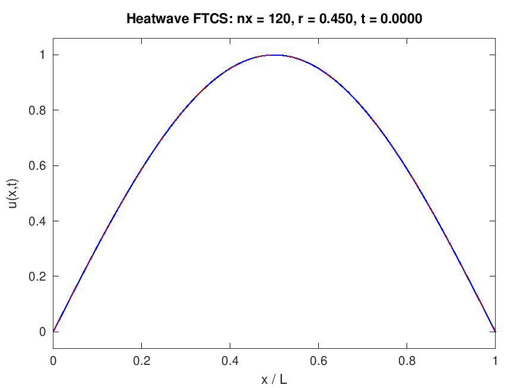

# Heatwave



*Animation provenance: every frame is an actual computed FTCS state of
`u_t = u_xx` (nx = 120, r = 0.450, 16000 steps from `sin(pi x)` with
Dirichlet ends), exported as a PNG by GNU Octave 11.3.0 through the
gnuplot toolkit and assembled into this 62-frame GIF (80 ms/frame) by
`tools/make_gif.py` (Python + Pillow). The dashed red curve in each
frame is the analytic decay `sin(pi x) e^{-pi^2 t}`. No frame is
synthesized or interpolated.*

Toolbox-free GNU Octave solvers for the transient heat diffusion
equation, verified against the analytic decaying sine solution with
measured convergence orders — plus an implicit scheme that keeps
working at time steps 32x beyond the explicit stability limit.

## Purpose and scope

Heatwave solves

```
du/dt = alpha * d2u/dx2     on [0, L],  u(x,0) = u0(x)
```

with fixed-temperature (Dirichlet) or insulated (Neumann) ends, using
two schemes written from scratch in MATLAB-compatible `.m` files:

- **FTCS** (explicit): vectorized update, hard stability guard
  `dt <= dx^2/(2 alpha)` that errors instead of silently clipping.
- **Implicit** (backward Euler): hand-written Thomas tridiagonal solve,
  unconditionally stable, for comparison and large time steps.

Everything is checked against the analytic solution
`u(x,t) = sin(m pi x/L) exp(-alpha (m pi/L)^2 t)` and its decaying
sine-series generalization (`src/exact_solution.m`).

## Model summary

| Item | Choice |
|---|---|
| Equation | `u_t = alpha u_xx` (1D slab, constant alpha) |
| Schemes | FTCS explicit; backward Euler implicit (own Thomas solver) |
| Boundary conditions | Dirichlet ends; insulated Neumann ends (ghost cells, mean-conserving) |
| Stability | FTCS guarded at `dt <= dx^2/(2 alpha)`; implicit unconditional |
| Accuracy | FTCS and implicit both `O(dt) + O(dx^2)` (measured below) |

Full derivation sketch (von Neumann stability, ghost-cell conservation,
series solution) in [docs/model.md](docs/model.md); function signatures
in [docs/api.md](docs/api.md).

## Quick start

Tested runtime: **GNU Octave 11.3.0** (the exact commands used to
produce the committed results, on this Windows machine):

```bat
set "PATH=C:\Users\KHALIL\AppData\Local\Programs\GNUOctave\11.3.0\octave-11.3.0-w64\mingw64\bin;%PATH%"

:: run the verification suite (9 tests, exits nonzero on failure)
octave-cli --no-gui --eval "run('tests/test_heatwave.m')"

:: regenerate every figure, the animation frames and run_summary.json
octave-cli --no-gui --eval "run('run_results.m')"

:: assemble the animated GIF from the exported frames (needs Pillow)
python tools\make_gif.py
```

On any system with Octave on PATH the same steps are
`octave --no-gui --eval "run('tests/test_heatwave.m')"` etc. The
sources use only core language features — MATLAB compatibility is a
stated goal of the code style, but the tested runtime is GNU Octave
11.3.0 (no MATLAB license was used to verify it).

Minimal solver example:

```matlab
addpath('src');
sol = heatwave('nx',100, 'tFinal',0.2, 'dt',2e-3, 'u0',@(x) sin(pi*x));
plot(sol.x, sol.U(end,:));              % FTCS with stability guard
solI = heatwave('scheme','implicit', 'nx',100, 'tFinal',0.2, 'dt',0.02);
```

## Measured results (GNU Octave 11.3.0)

All numbers below come from the committed verification suite and
`docs/results/run_summary.json`.

| Check | Result |
|---|---|
| FTCS vs analytic decay (`nx=40`, `r=0.444`) | max error 2.6e-4 / 3.2e-4 / 2.4e-4 at t = 0.05 / 0.10 / 0.20 |
| Spatial order, fixed `r~0.45`, `nx=10..160` | **1.989** (errors 4.94e-3 → 2.01e-5) |
| Temporal order, fixed `nx=200`, self-convergence | **1.000** (`\|U(dt)-U(dt/2)\|` halves exactly with dt) |
| Implicit at `dt = 0.01` (`r = 16`, **32x** the FTCS limit) | max error **1.34e-2** vs analytic |
| FTCS at that same `dt` (guard off) | diverges to **3.4e+28** (guard errors by default instead) |
| Stability guard, `nx=10` | `dt=0.006` rejected with `heatwave:unstableStep`; `dt=0.005` accepted unclipped |
| Insulated-slab mean conservation (4000 steps) | drift **1.3e-15** (FTCS), **1.8e-13** (implicit) |
| Pointwise error at `t=0.5`, `nx=120` cover run | max **3.45e-6** |
| Suite | **9/9 tests pass** in ~23 s (also run on every push by CI) |

One honest subtlety, documented in
[docs/model.md](docs/model.md): FTCS's leading time and space error
terms partially cancel near `r = 1/6`, so the raw error-vs-dt curve is
non-monotone; the temporal order is therefore measured by
self-convergence, which is insensitive to the cancellation.

## Verification summary

`tests/test_heatwave.m` covers (a) FTCS vs analytic decay at several
times within an `O(dt)+dx^2`-consistent tolerance, (b) implicit accuracy
at a step where FTCS is unstable, (c) the stability guard, (d) measured
orders in dx and dt, (e) roundoff-level mean conservation for insulated
ends, and (f) 23 invalid-input rejections. Per-test evidence with all
measured numbers: [docs/verification.md](docs/verification.md).

## Limitations

1D, constant diffusivity, linear, uniform grid, time-constant boundary
values; the Thomas solver omits pivoting (safe here by strict diagonal
dominance, not a general-purpose routine). See the end of
[docs/verification.md](docs/verification.md).

## License

MIT — see [LICENSE](LICENSE), Copyright (c) 2026 MOHAMMED AHMED.

## References (by title)

- *Numerical Solution of Partial Differential Equations: An
  Introduction* — K. W. Morton, D. F. Mayers
- *Finite Difference Schemes and Partial Differential Equations* —
  J. C. Strikwerda
- *Numerical Recipes: The Art of Scientific Computing* — W. H. Press
  et al.
- *Heat Conduction* — D. W. Hahn, M. N. Ozisik
